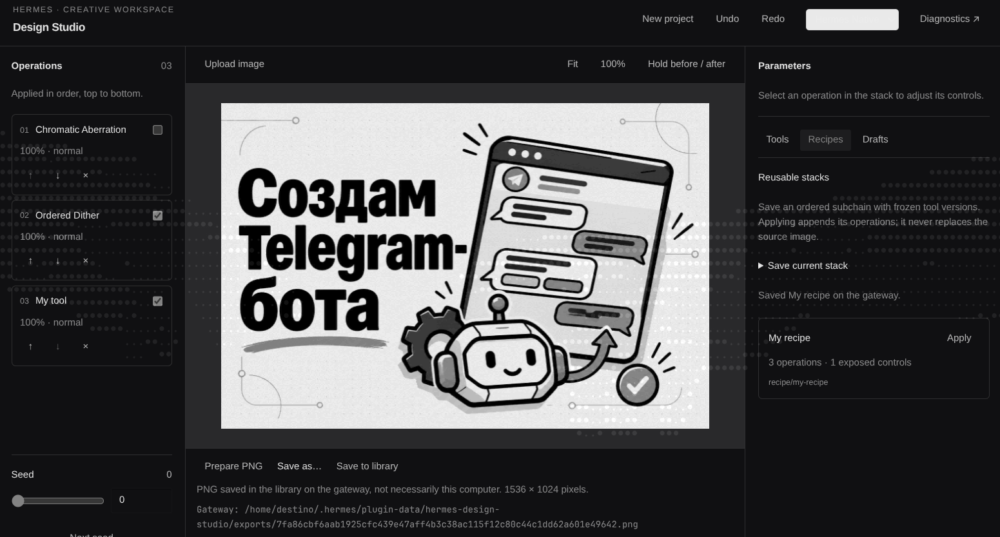
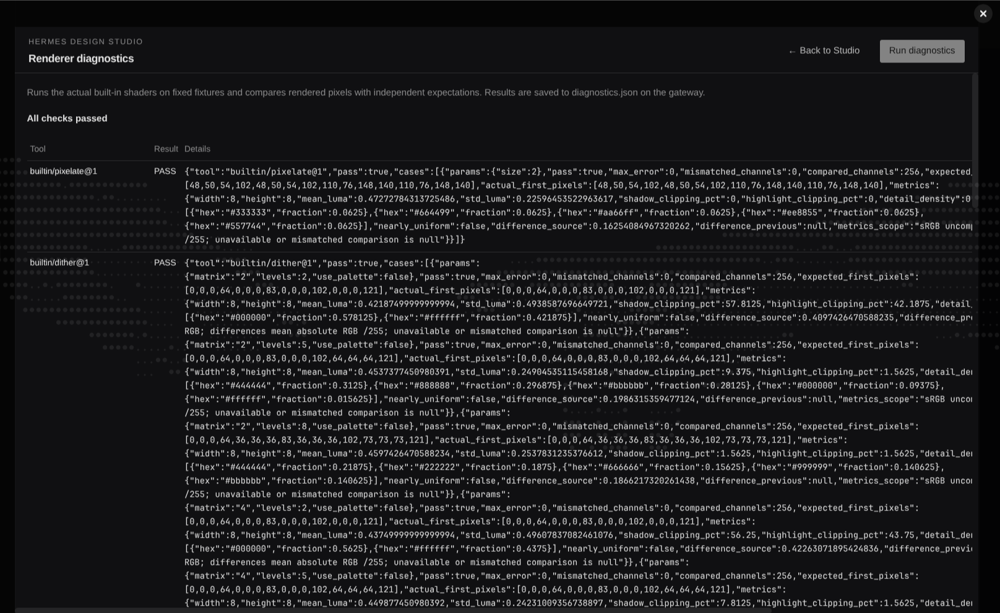

# Hermes Design Studio

A non-destructive image workshop inside **Hermes Desktop**. Build a shader stack with sliders, author a reusable shader, save a recipe, and export a PNG—entirely by hand or with a Hermes agent helping. The agent edits the same revision-checked project as the UI; it cannot approve its own tools.

**Delivery status:** local, unpublished build. P0, P1 and P2 have independent real-client verification, including actual fresh-session tool calls, human approval, command ids, rendered frames and PNG export. Final delivery records are kept in `BUILD-LOG.md` and `evidence/p3-final-install.json`. Catalog submission, public repository, PR, video, X post and form submission are **not yet done**. See [verification and architecture](docs/architecture-and-verification.md) and [submission drafts](SUBMISSION.md).

## What it does

- Seven built-in effects: **Pixelate**, **Ordered Dither** (Bayer 2/4/8, levels and optional two-color palette), **Halftone**, **Gradient Map**, **Grain**, **Chromatic Aberration**, and **Levels** (brightness, contrast, gamma, saturation).
- Ordered operations with enable/disable, opacity, normal/multiply/screen/overlay blending, parameter controls, seed, and backend undo/redo.
- Upload or drop a local image; fit/100% view and before/after comparison. Hermes Native and plugin-scoped Minimal interface themes do not change image pixels.
- Manual GLSL editor and parameter table, debounced compilation, line-numbered errors, and previews on the current image and a test fixture. **Only a human can approve a checked draft.**
- Reusable recipes freeze a versioned operation subchain and can expose selected parameters.
- Client **Save as…** and gateway **Save to library** are separate export paths.
- Agent previews include PNGs and numerical frame metrics. A vision-capable primary model is **not required**.

## Requirements

- Hermes with unified Python/Desktop plugin support, the Desktop plugin SDK and plugin REST API. Check the package's `plugin.yaml` for its declared Hermes requirement. This build was exercised on the developer's Hermes fork; compatibility with other Hermes builds must be validated, not inferred from a version string alone.
- A **POSIX gateway**: the backend uses `fcntl` file locking. Linux is tested; macOS is not verified here. A Windows gateway is not supported by this slice.
- A connected **Hermes Desktop window with WebGL2** and this plugin enabled. The Design Studio page may be closed; the service renderer lives for the window/plugin lifetime. A CLI/gateway alone cannot render, compile-check or export frames.
- No plugin Python dependencies, native-code payloads or WASM. The readable, unminified `desktop/plugin.js` is included; users do not need Node to install it.

## Install in two steps

These instructions start with an existing local Git checkout. There is **no published repository or catalog entry to fetch yet**. Run step 1 on the **gateway machine**, in the checkout, using the intended Hermes profile/environment. The CLI options below were checked against real `--help` output. See the final delivery record for the exact locally installed Git commit and validation output.

1. **Install the committed package and enable its backend:**

   ```bash
   hermes plugins install "file://$(pwd)" --ref "$(git rev-parse HEAD)" --force --enable
   ```

   **Local trust override:** `--force` also overrides the install scanner. This command is only for this reviewed, self-authored local checkout: the generic scanner flags development-log strings, negative security-test fixtures and legitimate image-header/base64 code. A normal local-source install was blocked with CAUTION; that result is preserved in the delivery evidence. Do not copy this override for unreviewed third-party plugins, and do not disable scanning globally.

   The source must be a Git repository; `--ref` pins its full 40-character commit, not uncommitted edits. Hermes accepts `file://` URLs and may show a local-source security warning. Review the source before confirming. Use your active profile's `HERMES_HOME`; do not install into an unrelated profile. You can inspect the result with `hermes plugins info hermes-design-studio` and validate the installed directory with `hermes plugins validate "$HERMES_HOME/plugins/hermes-design-studio"` (use `~/.hermes/plugins/hermes-design-studio` for the default home when `HERMES_HOME` is unset).

2. **Load and enable the Desktop half on the client:**

   With a local gateway, Desktop discovers the unified package's `desktop/plugin.js`. In **Capabilities → Plugins**, rescan if needed and enable **Hermes Design Studio**. Reload/reconnect the actual serving backend/Desktop when Python routes or tool registration changed, then start a **new agent session** for new tools. Open **Design Studio** from the sidebar or command palette. Do not restart a gateway from the agent session it is serving.

   With a **remote gateway**, the backend install is not a client install. Copy the committed `desktop/plugin.js` to the Desktop computer's app-level `$HERMES_HOME/desktop-plugins/hermes-design-studio/plugin.js`, then enable/refresh it there and reconnect to the same gateway/profile. Keep frontend and backend on the same commit. The remote server's filesystem is not the laptop's filesystem. Use a **gateway-token connection for Upload**: the current SDK's multipart upload is unavailable over OAuth remotes. The plugin reports that limitation rather than bypassing authentication.

For existing installations, inspect `hermes plugins install --help` before using its `--force` replacement option. Backend enablement and Desktop enablement are independent. Source edits are not automatically a refreshed installed or app-level copy.

## Use it without an agent

1. Open Design Studio and choose **Upload image**, or drop an image on the workspace. This selects a file on **this Desktop computer**. The browser decodes it locally, checks the GPU texture limit, shows a local preview, then uploads a normalized PNG in chunks of at most 4 MiB. Wait for upload/project confirmation; a local preview alone is not persistence.
2. Add effects from **Tools**. Select an operation to adjust its controls; reorder, disable or remove operations and change opacity/blend. Use Undo/Redo to revise the stack. If a color effect seems absent, inspect enabled state and later effects: grayscale dither after chromatic aberration removes its colored fringes.
3. In **Drafts**, create/edit a shader and its parameter schema. Write the GLSL body, not the renderer's declarations. Inspect compilation errors and both previews, then explicitly click **Approve tool**. The checked shader and parameter-schema fingerprints must still match; edits invalidate the check. A new slider has no effect until the shader uses its `p_<name>` uniform.
4. Add the approved version from Tools. In **Recipes**, choose operations and exposed parameters, then save the subchain. Applying a recipe appends its operations; it does not replace the source.
5. **Prepare PNG → Save as…** opens the native save flow on the **client**. **Save to library** writes a PNG into gateway plugin-data and shows its path. A gateway path is not a local download; copy it explicitly if needed.

## Use it with an agent

Load the bundled skill **`hermes-design-studio:usage`** in a new session. For example:

> Read the current Design Studio project and catalog. Add a subtle halftone treatment, show a fresh preview, and save the result to the gateway library. Do not replace the source.

Or ask the agent to propose a new shader draft. **Review and approve that draft yourself in the UI**, then ask the agent to re-read the catalog and apply the approved version. The seven tools are:

| Tool | Purpose |
|---|---|
| `design_studio_catalog(query?)` | Validated built-ins, approved tools, drafts, recipes and parameter schemas. |
| `design_studio_project(action, path?)` | `get`, `new`, or `import_image` from an explicit **gateway** path. |
| `design_studio_apply(project_id, base_revision, commands)` | One atomic command batch, returning command identity and the new document. |
| `design_studio_preview(max_size?)` | PNG plus metrics; longest side at most **1600 px**. |
| `design_studio_create_tool(name, description, params, shader)` | Save a draft and request real compilation/fixture checking; **never approval**. |
| `design_studio_recipe(action, …)` | Save/list a frozen subchain, or apply it using project identity and revision. |
| `design_studio_export(format: "png")` | Full-resolution PNG in gateway `exports/`, with path, dimensions and SHA-256. |

Every mutation checks **project identity plus base revision** under the backend lock. A stale identity/revision returns **409** with the current document; no silent merge or replay into a replacement project. Re-read, reconsider the change, and explicitly retry against the intended project.

### Without vision

Preview and tool-check results contain `text_summary`: dimensions, mean luma, contrast (luma standard deviation), shadow/highlight clipping percentages, five dominant colors and shares, detail density (mean gradient), source/previous-frame differences and a nearly-uniform flag. Unavailable comparisons are `null`, not fabricated zeros; source-less fixtures are labeled.

Hermes can substitute this summary for image content when the primary model lacks vision. It supports technical feedback, **not equivalent visual judgment**. An available auxiliary `vision_analyze` can inspect the returned PNG path, but is optional. Check project/revision and `stale` before claiming a preview represents the latest edit. No connected renderer means a pending/error response or an explicitly stale cached preview, not invented success; request waits are bounded at 10 seconds.

## Files and remote topology

| Item | Where it lives |
|---|---|
| Backend package | Gateway: `<HERMES_HOME>/plugins/hermes-design-studio/` |
| Desktop entry | Desktop computer: app-level `desktop-plugins/hermes-design-studio/plugin.js` |
| Projects, `commands.jsonl`, assets, drafts, approved tools, recipes, requests/responses, diagnostics and exports | Gateway: `<HERMES_HOME>/plugin-data/hermes-design-studio/` |
| Upload picker / drag-and-drop / native Save as | Desktop computer |
| Agent `import_image(path)` | Reads an explicit path on the gateway, **not the client** |

The plugin never stores user creations in or rewrites its installed code. Content-addressed assets and versioned references make projects reusable. Unknown document/manifest formats are rejected without deleting them.

## Architecture and limits

`studio_core/` is a Hermes-independent Python state/catalog/filesystem core. `core/` is a Hermes-independent WebGL2 renderer, metrics and diagnostics core. Thin Python and Desktop adapters connect them through revision-checked commands, durable file requests/responses, events and polling. The backend is the source of truth; JavaScript does not reimplement command semantics. See [architecture and verification](docs/architecture-and-verification.md).

- **Static images only.** Project `timeline` is `null`; reserved shader `u_time` is always **0.0**. Animation, timeline editing and animated export are not implemented.
- **Preview ≤1600 px** on the longest side. **PNG export ≤4096 px per side** at source resolution; larger images fail explicitly, with no silent export downscale. The client's actual `MAX_TEXTURE_SIZE` is another limit.
- **Server-path import supports PNG, JPEG and static WebP headers**, including JPEG orientation metadata. This is a stdlib **header/metadata check, not full image decoding**. Corrupt compressed pixels may fail only when the browser decodes them. Animated WebP and other server-import formats are unsupported. There is no server-import file-size ceiling, but memory, disk, browser decode and GPU limits still apply. UI Upload uses the browser decoder and normalizes accepted images to PNG.
- **Not a GPU sandbox.** Backend static checks reject `while`/`do`, nonliteral or over-256 `for` bounds, shader source over **32 KiB**, and invalid parameter declarations. Those checks only reject obvious risks; they **do not prevent GPU hangs or guarantee bounded work**. Do not run untrusted, deliberately expensive shaders or hang probes.
- No arbitrary HTML/JavaScript tools, `eval`, native payloads, WASM or minified bundle. These exclusions do not turn GLSL into a hardened sandbox.
- sRGB 8-bit input, straight alpha, RGBA8 render targets; not a color-managed/HDR/print-production workflow.
- Human approval is a required review step, not a security audit. Only approve source you understand. A successful compile alone is not proof of a useful effect.
- OAuth remote multipart Upload is unsupported by the current SDK; use a gateway-token connection. Save as belongs to the client, library export to the gateway.

## Verification snapshot

At code checkpoint `f3aef873e24173a28677c8f28606175762e60b55`:

- **355 Python tests passed, 55 JavaScript tests passed** in the parent's recorded run. **8 known fork warnings** remain from Linux multiprocessing in a multithreaded test process; they are not suppressed or counted as failures.
- P0 real Desktop evidence covers a detached renderer with the Studio page closed, chunked upload with matching SHA-256, multimodal preview through host isolation, and human-confirmed native Save as.
- P1 real Desktop diagnostics pass for all seven built-ins. The user manually authored/approved/applied a tool without the agent. A gateway PNG export was fully decoded and checked independently.
- P2 isolated integration exercised all seven registered handlers through a real PluginHost and separate Chromium WebGL renderer. **That alone is not actual LLM/client proof.** Separately, fresh session `20261111_222455_71cfd9` was correlated with real command ids at revisions 28→29→30, the exact agent-authored/human-approved shader snapshot, current client frames and a SHA/Pillow-verified 1536×1024 export. See `evidence/p2-runtime-verification.json`.
- P3 is recorded separately against its exact local Git installation commit; consult `BUILD-LOG.md` and `evidence/p3-final-install.json`. A draft catalog file is not a submitted/admitted entry, and validation is not publication.

No full suite was rerun for this documentation-only change. Development test/build commands and evidence boundaries are in [the verification guide](docs/architecture-and-verification.md).

## Real client screenshots

User-supplied P1 captures, cropped only to remove surrounding navigation or bottom server paths. These are actual UI captures, not generated mockups. The diagnostic image shows a partial table; the complete seven-tool PASS record is in the real-client JSON evidence.




## Roadmap—not shipped

Animation/timeline controls and animated export; a branching node graph; composite-tool UI beyond saved recipes; tiled exports above 4096 px; Windows gateway locking support; broader server-path image formats/full decoding; additional color-management workflows. These are possibilities, not implemented features or delivery promises. Arbitrary executable HTML tools are outside this build.

## License and AI-assisted disclosure

[MIT](LICENSE). Created by **1lpredest1nato**, with implementation, tests, documentation and review assistance from **Hermes Agent by Nous Research**. Human decisions, manual tool approval and final publication remain with the author. This is an independent community plugin, not a claim of official Nous Research endorsement. See [SUBMISSION.md](SUBMISSION.md) for the disclosure and unpublished submission drafts.
